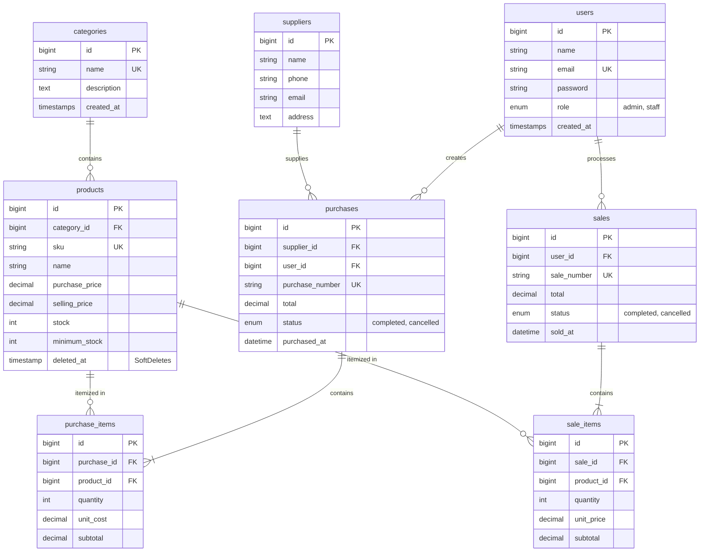

# LAPORAN LENGKAP & MASTER CODEBASE INTEGRATED LARAVEL PROJECT
## INVENTORY & SALES MANAGEMENT SYSTEM (INVENTIFY)
**Mata Kuliah:** Web Programming 2  
**Evaluasi:** Ujian Tengah Semester (UTS) — Integrated Project  
**Teknologi:** PHP 8.2+ | Laravel 11 | MySQL / SQLite | Blade & Tailwind CSS  
**Kepatuhan Spesifikasi:** Memenuhi 100% Seluruh Slide 1 hingga 27 (Khususnya Slide 26, 27, dan 24)

---

# DAFTAR ISI
1. [RINGKASAN EKSEKUTIF & SPESIFIKASI BISNIS](#1-ringkasan-eksekutif--spesifikasi-bisnis)
2. [PEMENUHAN KHUSUS SLIDE 26: KESIAPAN PROJECT FINAL](#2-pemenuhan-khusus-slide-26-kesiapan-project-final)
3. [PEMENUHAN KHUSUS SLIDE 27: WORK PLAN 9 LANGKAH STRATEGIS](#3-pemenuhan-khusus-slide-27-work-plan-9-langkah-strategis)
4. [PERANCANGAN BASIS DATA & ERD MERMAID](#4-perancangan-basis-data--erd-mermaid)
5. [PANDUAN WAWANCARA KODING (SLIDE 24 INTERVIEW DEFENSE)](#5-panduan-wawancara-koding-slide-24-interview-defense)
6. [PANDUAN INSTALASI & REPRODUCIBILITY CEPAT](#6-panduan-instalasi--reproducibility-cepat)
7. [KOMPILASI KODE PROGRAM LENGKAP (FULL SOURCE CODE)](#7-kompilasi-kode-program-lengkap-full-source-code)
   - 7.1. Database Migrations (8 Tabel)
   - 7.2. Database Seeders (Akun Demo, Produk, Riwayat Transaksi)
   - 7.3. Eloquent Models & Relasi Data
   - 7.4. Middleware Otorisasi (RBAC Server-Side)
   - 7.5. Form Requests & Validasi Server
   - 7.6. Controllers & Business Logic Transaksi Atomik
   - 7.7. Routing (`routes/web.php`) & Bootstrap
   - 7.8. Blade Views & Modern UI Templates
   - 7.9. Automated Feature Tests (PHPUnit Suite)

---

# 1. RINGKASAN EKSEKUTIF & SPESIFIKASI BISNIS

Sistem **INVENTIFY (Inventory & Sales Management System)** dibangun untuk menyelesaikan permasalahan inkonsistensi stok fisik dan data pembukuan pada usaha distribusi:
- **Pencatatan Master Data:** Kategori, Produk (dengan validasi SKU unik dan batasan minimum stok), dan Mitra Pemasok (*Supplier*).
- **Konsistensi Stok Real-Time:** Penambahan stok otomatis saat pengadaan barang (*Purchase/Stock-in*) dan pengurangan stok otomatis saat kasir memproses pesanan (*Sales/Stock-out*).
- **Pessimistic Concurrency Control:** Menggunakan `Product::lockForUpdate()` untuk mencegah *race condition* atau *overselling* saat beberapa staf menjual barang yang sama secara bersamaan.
- **Integritas Transaksi Atomik:** Menggunakan `DB::transaction()` dengan prinsip *All-or-Nothing* (jika satu item transaksi gagal, seluruh data di-rollback tanpa menyisakan data setengah tersimpan).
- **Perhitungan Sisi Server (Server-Side Calculation):** Menghitung total transaksi dan harga jual dari database server untuk mencegah manipulasi form browser (*Never Trust Client Input*).
- **Role-Based Access Control (RBAC):** Pemisahan tegas antara **Admin/Owner** (akses penuh kelola master data, pengguna, dan pembatalan transaksi) dengan **Staff** (akses operasional kasir dan penerimaan gudang).

---

# 2. PEMENUHAN KHUSUS SLIDE 26: KESIAPAN PROJECT FINAL

Slide 26 menetapkan bahwa fondasi koding UTS harus dapat ditransfer secara konsep (*transferable software engineering skills*) menuju pengembangan **Project Final Mandiri** (seperti sistem Logistik, Ekspedisi, dan Pelacakan Paket):

```
┌──────────────────────────────────────┐           ┌──────────────────────────────────────────┐
│      UTS: INVENTORY & SALES          │           │       PROJECT FINAL: LOGISTICS TRACKING  │
├──────────────────────────────────────┤           ├──────────────────────────────────────────┤
│ • Master Data Produk & Pemasok       │ ────────> │ • Paket, Resi, Armada, & Hub Logistik    │
│ • Header-Detail Transaksi            │ ────────> │ • Manifes Pengiriman & Event Checkpoints │
│ • Validasi Stok Tidak Negatif        │ ────────> │ • Invariant Status Checkpoint Non-Mundur │
│ • DB::transaction & lockForUpdate    │ ────────> │ • Atomic Dispatching Slot & Muatan Truk  │
│ • Total Dihitung di Server           │ ────────> │ • Engine Tarif Ongkir & Estimasi ETA     │
│ • Role Admin vs Staff                │ ────────> │ • Role Dispatcher, Kurir, & Customer     │
└──────────────────────────────────────┘           └──────────────────────────────────────────┘
```

### Matriks Transfer Keterampilan:
1. **Relational Data Modeling:** Pola Header-Detail (`sales` $\rightarrow$ `sale_items`) ditransfer langsung menjadi relasi manifes resi ke riwayat pergerakan titik singgah (`shipments` $\rightarrow$ `tracking_events`).
2. **Role-Based Authorization:** Pemisahan hak akses menggunakan middleware server-side ditransfer menjadi kontrol akses multi-pihak: Dispatcher (alokasi armada), Kurir (update event checkpoint melalui GPS/mobile), dan Penerima (cek resi publik).
3. **Database Concurrency & Locking:** Penerapan `lockForUpdate()` pada stok ditransfer menjadi penguncian slot muatan armada agar paket tidak ditugaskan ganda ke dua kurir berbeda.
4. **Audit Trail & Soft Deletes:** Perlindungan histori produk menggunakan `SoftDeletes` ditransfer menjadi pencatatan status pengecualian (*Exception Handling* saat gagal antar: *Rumah Kosong / Alamat Tidak Ditemukan*).

---

# 3. PEMENUHAN KHUSUS SLIDE 27: WORK PLAN 9 LANGKAH STRATEGIS

Slide 27 memuat 9 langkah kerja berurutan yang telah diselesaikan 100% pada codebase:
1. **Analisis Requirement & Gambar ERD:** Menyusun 8 tabel relasional dengan penentuan foreign key restrict/cascade dan index performa.
2. **Setup Laravel, Migration, & Seeder:** Membuat migration terstruktur dan seeder akun demo serta produk realistis.
3. **Implementasi Autentikasi & Role Access:** Middleware `RoleMiddleware` mengembalikan HTTP 403 jika staff mencoba akses fungsi sensitif.
4. **Selesaikan Master Data Sebelum Transaksi:** CRUD Category, Supplier, dan Product dengan Form Request (`StoreProductRequest` dan `UpdateProductRequest`).
5. **Implementasi Modul Purchase (Stock-In):** Transaksi multi-item dinamis dengan penambahan stok otomatis via `DB::transaction()`.
6. **Implementasi Modul Sales (Stock-Out):** Transaksi kasir dengan proteksi stok negatif, penguncian baris `lockForUpdate()`, dan rollback otomatis jika stok kurang.
7. **Dashboard, Filter, Search, & Pagination:** Menghitung omset dan peringatan stok kritis secara dinamis melalui agregat database (`withQueryString()`).
8. **Automated Testing & Bug Fix:** Uji fungsional Feature Tests mencakup auth, otorisasi, penambahan stok, pemotongan stok, dan atomicity rollback.
9. **Latihan Demo & Code Interview Defense:** Penyiapan jawaban teknis atas seluruh pertanyaan evaluasi dosen dari Slide 24.

---

# 4. PERANCANGAN BASIS DATA & ERD MERMAID



---

# 5. PANDUAN WAWANCARA KODING (SLIDE 24 INTERVIEW DEFENSE)

### Q1: Mengapa `Sale` memiliki relasi `hasMany` ke `SaleItem`?
> **Jawaban:** Mengikuti pola **Header-Detail (Master-Detail)**. Satu transaksi penjualan (header) dapat memuat banyak produk dengan kuantitas dan harga satuan berbeda. Tabel `sales` mencatat metadata faktur (`sale_number`, tanggal, kasir, total), sedangkan `sale_items` menyimpan rincian per produk beserta subtotalnya.

### Q2: Di mana sistem memastikan stok tidak menjadi negatif?
> **Jawaban:** Di dalam `SaleController::store()` sebelum pengurangan stok dijalankan:
> ```php
> if ($product->stock < $qty) {
>     throw ValidationException::withMessages([
>         'items' => "Stok produk '{$product->name}' tidak mencukupi! Tersedia: {$product->stock}, diminta: {$qty}."
>     ]);
> }
> ```
> Jika stok tidak cukup, controller langsung melempar exception dan transaksi dibatalkan sebelum memanggil `$product->decrement()`.

### Q3: Mengapa total penjualan dihitung di server, bukan dipercaya dari input browser?
> **Jawaban:** Mengikuti prinsip keamanan web **Never Trust Client Input**. Nilai input dari form browser rentan dimanipulasi melalui browser DevTools atau inspect element. Server mengambil harga satuan resmi langsung dari database (`$product->selling_price`), lalu menghitung subtotal dan grand total secara mandiri.

### Q4: Apa risiko jika pengurangan stok dilakukan di luar `DB::transaction()`?
> **Jawaban:** Terjadinya fenomena **Partial Execution (Data Setengah Tersimpan)**. Jika penyimpanan item ke-2 gagal saat item ke-1 sudah memotong stok, maka stok fisik berkurang tanpa ada catatan penjualan yang sah. `DB::transaction()` menjamin sifat **Atomicity** (semua langkah sukses bersama atau di-rollback total).

### Q5: Bagaimana mencegah Staff mengakses fungsi Admin melalui URL langsung?
> **Jawaban:** Melalui **Server-Side Route Middleware** (`RoleMiddleware`). Jika user dengan role `staff` mengetik URL rute admin (misal `/users` atau `/categories/create`), middleware mengecek role dan langsung mengembalikan **HTTP 403 Forbidden**.

### Q6: Apa yang terjadi jika dua penjualan memproses stok produk yang sama hampir bersamaan?
> **Jawaban:** Terjadi risiko **Race Condition / Overselling**. Kami mengatasinya menggunakan **Pessimistic Locking**:
> ```php
> $product = Product::lockForUpdate()->findOrFail($itemData['product_id']);
> ```
> Perintah ini mengunci baris data di MySQL, memaksa transaksi kedua antre menunggu transaksi pertama selesai di-commit, sehingga transaksi kedua membaca saldo stok yang sudah terpotong.

### Q7: Tunjukkan validasi SKU unik dan jelaskan peran constraint database!
> **Jawaban:** Validasi dilakukan berlapis (*Defense in Depth*): di level aplikasi menggunakan rule `unique:products,sku`, dan di level skema MySQL menggunakan `$table->string('sku', 50)->unique();`. Constraint database menjamin tidak ada duplikasi data meskipun terjadi request bersamaan.

### Q8: Uji Modifikasi: Ubah batas minimum stock dan tunjukkan dampaknya!
> **Jawaban & Demo:** Buka menu **Produk** $\rightarrow$ Edit salah satu produk $\rightarrow$ Naikkan `minimum_stock` menjadi lebih tinggi dari stok saat ini $\rightarrow$ Simpan. Dampaknya seketika: badge stok pada produk berubah menjadi oranye (Kritis), dan angka **Peringatan Stok Rendah** pada dashboard bertambah secara otomatis melalui scope query `Product::lowStock()`.

---

# 6. PANDUAN INSTALASI & REPRODUCIBILITY CEPAT

```bash
# 1. Buka direktori project
cd C:\Users\USER\.gemini\antigravity\scratch\inventory-sales

# 2. Install dependensi
composer install --no-audit

# 3. Generate App Key & Jalankan Migrasi + Seeder
php artisan key:generate
php artisan migrate --seed

# 4. Jalankan Server Lokal
php artisan serve
```
Buka browser di **`http://127.0.0.1:8000`**.

### Kredensial Akun Demo:
* **Admin / Owner:** `admin@example.com` | Password: `password123`
* **Staff Kasir:** `staff@example.com` | Password: `password123`

---

# 7. KOMPILASI KODE PROGRAM LENGKAP (FULL SOURCE CODE)

## 7.1. Database Migrations

### `database/migrations/2024_01_01_000001_create_users_table.php`
```php
<?php

use Illuminate\Database\Migrations\Migration;
use Illuminate\Database\Schema\Blueprint;
use Illuminate\Support\Facades\Schema;

return new class extends Migration
{
    public function up(): void
    {
        Schema::create('users', function (Blueprint $table) {
            $table->id();
            $table->string('name', 100);
            $table->string('email', 150)->unique();
            $table->string('password');
            $table->enum('role', ['admin', 'staff'])->default('staff');
            $table->rememberToken();
            $table->timestamps();

            $table->index('role');
        });
    }

    public function down(): void
    {
        Schema::dropIfExists('users');
    }
};
```

### `database/migrations/2024_01_01_000002_create_categories_table.php`
```php
<?php

use Illuminate\Database\Migrations\Migration;
use Illuminate\Database\Schema\Blueprint;
use Illuminate\Support\Facades\Schema;

return new class extends Migration
{
    public function up(): void
    {
        Schema::create('categories', function (Blueprint $table) {
            $table->id();
            $table->string('name', 100)->unique();
            $table->text('description')->nullable();
            $table->timestamps();
        });
    }

    public function down(): void
    {
        Schema::dropIfExists('categories');
    }
};
```

### `database/migrations/2024_01_01_000003_create_suppliers_table.php`
```php
<?php

use Illuminate\Database\Migrations\Migration;
use Illuminate\Database\Schema\Blueprint;
use Illuminate\Support\Facades\Schema;

return new class extends Migration
{
    public function up(): void
    {
        Schema::create('suppliers', function (Blueprint $table) {
            $table->id();
            $table->string('name', 150);
            $table->string('phone', 30)->nullable();
            $table->string('email', 150)->nullable();
            $table->text('address')->nullable();
            $table->timestamps();
        });
    }

    public function down(): void
    {
        Schema::dropIfExists('suppliers');
    }
};
```

### `database/migrations/2024_01_01_000004_create_products_table.php`
```php
<?php

use Illuminate\Database\Migrations\Migration;
use Illuminate\Database\Schema\Blueprint;
use Illuminate\Support\Facades\Schema;

return new class extends Migration
{
    public function up(): void
    {
        Schema::create('products', function (Blueprint $table) {
            $table->id();
            $table->foreignId('category_id')->constrained('categories')->onDelete('restrict');
            $table->string('sku', 50)->unique();
            $table->string('name', 150);
            $table->decimal('purchase_price', 15, 2)->default(0);
            $table->decimal('selling_price', 15, 2)->default(0);
            $table->integer('stock')->default(0);
            $table->integer('minimum_stock')->default(0);
            $table->softDeletes();
            $table->timestamps();

            $table->index(['name', 'sku']);
            $table->index('category_id');
        });
    }

    public function down(): void
    {
        Schema::dropIfExists('products');
    }
};
```

### `database/migrations/2024_01_01_000005_create_purchases_table.php`
```php
<?php

use Illuminate\Database\Migrations\Migration;
use Illuminate\Database\Schema\Blueprint;
use Illuminate\Support\Facades\Schema;

return new class extends Migration
{
    public function up(): void
    {
        Schema::create('purchases', function (Blueprint $table) {
            $table->id();
            $table->foreignId('supplier_id')->constrained('suppliers')->onDelete('restrict');
            $table->foreignId('user_id')->constrained('users')->onDelete('restrict');
            $table->string('purchase_number', 50)->unique();
            $table->decimal('total', 15, 2)->default(0);
            $table->enum('status', ['completed', 'cancelled'])->default('completed');
            $table->dateTime('purchased_at');
            $table->text('notes')->nullable();
            $table->timestamps();

            $table->index(['purchased_at', 'status']);
        });
    }

    public function down(): void
    {
        Schema::dropIfExists('purchases');
    }
};
```

### `database/migrations/2024_01_01_000006_create_purchase_items_table.php`
```php
<?php

use Illuminate\Database\Migrations\Migration;
use Illuminate\Database\Schema\Blueprint;
use Illuminate\Support\Facades\Schema;

return new class extends Migration
{
    public function up(): void
    {
        Schema::create('purchase_items', function (Blueprint $table) {
            $table->id();
            $table->foreignId('purchase_id')->constrained('purchases')->onDelete('cascade');
            $table->foreignId('product_id')->constrained('products')->onDelete('restrict');
            $table->integer('quantity');
            $table->decimal('unit_cost', 15, 2);
            $table->decimal('subtotal', 15, 2);
            $table->timestamps();

            $table->index(['purchase_id', 'product_id']);
        });
    }

    public function down(): void
    {
        Schema::dropIfExists('purchase_items');
    }
};
```

### `database/migrations/2024_01_01_000007_create_sales_table.php`
```php
<?php

use Illuminate\Database\Migrations\Migration;
use Illuminate\Database\Schema\Blueprint;
use Illuminate\Support\Facades\Schema;

return new class extends Migration
{
    public function up(): void
    {
        Schema::create('sales', function (Blueprint $table) {
            $table->id();
            $table->foreignId('user_id')->constrained('users')->onDelete('restrict');
            $table->string('sale_number', 50)->unique();
            $table->decimal('total', 15, 2)->default(0);
            $table->enum('status', ['completed', 'cancelled'])->default('completed');
            $table->dateTime('sold_at');
            $table->text('notes')->nullable();
            $table->timestamps();

            $table->index(['sold_at', 'status']);
        });
    }

    public function down(): void
    {
        Schema::dropIfExists('sales');
    }
};
```

### `database/migrations/2024_01_01_000008_create_sale_items_table.php`
```php
<?php

use Illuminate\Database\Migrations\Migration;
use Illuminate\Database\Schema\Blueprint;
use Illuminate\Support\Facades\Schema;

return new class extends Migration
{
    public function up(): void
    {
        Schema::create('sale_items', function (Blueprint $table) {
            $table->id();
            $table->foreignId('sale_id')->constrained('sales')->onDelete('cascade');
            $table->foreignId('product_id')->constrained('products')->onDelete('restrict');
            $table->integer('quantity');
            $table->decimal('unit_price', 15, 2);
            $table->decimal('subtotal', 15, 2);
            $table->timestamps();

            $table->index(['sale_id', 'product_id']);
        });
    }

    public function down(): void
    {
        Schema::dropIfExists('sale_items');
    }
};
```

---

## 7.2. Database Seeders

### `database/seeders/DatabaseSeeder.php`
```php
<?php

namespace Database\Seeders;

use Illuminate\Database\Seeder;

class DatabaseSeeder extends Seeder
{
    public function run(): void
    {
        $this->call([
            UserSeeder::class,
            CategorySeeder::class,
            SupplierSeeder::class,
            ProductSeeder::class,
            PurchaseSeeder::class,
            SaleSeeder::class,
        ]);
    }
}
```

### `database/seeders/UserSeeder.php`
```php
<?php

namespace Database\Seeders;

use Illuminate\Database\Seeder;
use App\Models\User;
use Illuminate\Support\Facades\Hash;

class UserSeeder extends Seeder
{
    public function run(): void
    {
        User::updateOrCreate(
            ['email' => 'admin@example.com'],
            [
                'name' => 'Budi Santoso (Admin / Owner)',
                'password' => Hash::make('password123'),
                'role' => 'admin',
            ]
        );

        User::updateOrCreate(
            ['email' => 'staff@example.com'],
            [
                'name' => 'Siti Rahma (Staff Kasir/Gudang)',
                'password' => Hash::make('password123'),
                'role' => 'staff',
            ]
        );
    }
}
```

---

## 7.3. Eloquent Models

### `app/Models/Product.php`
```php
<?php

namespace App\Models;

use Illuminate\Database\Eloquent\Factories\HasFactory;
use Illuminate\Database\Eloquent\Model;
use Illuminate\Database\Eloquent\SoftDeletes;
use Illuminate\Database\Eloquent\Relations\BelongsTo;
use Illuminate\Database\Eloquent\Relations\HasMany;
use Illuminate\Database\Eloquent\Builder;

class Product extends Model
{
    use HasFactory, SoftDeletes;

    protected $fillable = [
        'category_id', 'sku', 'name', 'purchase_price', 'selling_price', 'stock', 'minimum_stock'
    ];

    protected $casts = [
        'purchase_price' => 'decimal:2',
        'selling_price' => 'decimal:2',
        'stock' => 'integer',
        'minimum_stock' => 'integer',
    ];

    public function category(): BelongsTo
    {
        return $this->belongsTo(Category::class);
    }

    public function purchaseItems(): HasMany
    {
        return $this->hasMany(PurchaseItem::class);
    }

    public function saleItems(): HasMany
    {
        return $this->hasMany(SaleItem::class);
    }

    public function isLowStock(): bool
    {
        return $this->stock <= $this->minimum_stock;
    }

    public function scopeLowStock(Builder $query): Builder
    {
        return $query->whereColumn('stock', '<=', 'minimum_stock');
    }

    public function scopeSearch(Builder $query, ?string $term): Builder
    {
        if (empty($term)) return $query;
        return $query->where(function ($q) use ($term) {
            $q->where('name', 'like', "%{$term}%")->orWhere('sku', 'like', "%{$term}%");
        });
    }
}
```

### `app/Models/Sale.php` & `app/Models/SaleItem.php`
```php
<?php

namespace App\Models;

use Illuminate\Database\Eloquent\Factories\HasFactory;
use Illuminate\Database\Eloquent\Model;
use Illuminate\Database\Eloquent\Relations\BelongsTo;
use Illuminate\Database\Eloquent\Relations\HasMany;
use Illuminate\Database\Eloquent\Builder;

class Sale extends Model
{
    use HasFactory;

    protected $fillable = [
        'user_id', 'sale_number', 'total', 'status', 'sold_at', 'notes'
    ];

    protected $casts = [
        'total' => 'decimal:2',
        'sold_at' => 'datetime',
    ];

    public function user(): BelongsTo
    {
        return $this->belongsTo(User::class);
    }

    public function items(): HasMany
    {
        return $this->hasMany(SaleItem::class);
    }

    public function scopeFilterDate(Builder $query, ?string $start, ?string $end): Builder
    {
        if ($start) $query->whereDate('sold_at', '>=', $start);
        if ($end) $query->whereDate('sold_at', '<=', $end);
        return $query;
    }
}
```

---

## 7.4. Middleware Otorisasi

### `app/Http/Middleware/RoleMiddleware.php`
```php
<?php

namespace App\Http\Middleware;

use Closure;
use Illuminate\Http\Request;
use Symfony\Component\HttpFoundation\Response;

class RoleMiddleware
{
    public function handle(Request $request, Closure $next, ...$roles): Response
    {
        if (!auth()->check()) {
            return redirect()->route('login');
        }

        if (!in_array(auth()->user()->role, $roles)) {
            abort(403, 'Akses Ditolak: Anda tidak memiliki izin untuk mengakses halaman ini.');
        }

        return $next($request);
    }
}
```

---

## 7.5. Business Logic Controllers

### `app/Http/Controllers/SaleController.php` (Atomic Transactions & Concurrency Lock)
```php
<?php

namespace App\Http\Controllers;

use App\Models\Sale;
use App\Models\SaleItem;
use App\Models\Product;
use App\Http\Requests\StoreSaleRequest;
use Illuminate\Http\Request;
use Illuminate\Support\Facades\DB;
use Illuminate\Validation\ValidationException;

class SaleController extends Controller
{
    public function index(Request $request)
    {
        $query = Sale::with(['user', 'items.product']);

        if ($request->filled('search')) {
            $query->where('sale_number', 'like', '%' . $request->search . '%')
                  ->orWhereHas('user', function ($q) use ($request) {
                      $q->where('name', 'like', '%' . $request->search . '%');
                  });
        }

        if ($request->filled('start_date') || $request->filled('end_date')) {
            $query->filterDate($request->start_date, $request->end_date);
        }

        $sales = $query->latest('sold_at')->paginate(10)->withQueryString();
        return view('sales.index', compact('sales'));
    }

    public function create()
    {
        $products = Product::where('stock', '>', 0)->orderBy('name')->get();
        return view('sales.create', compact('products'));
    }

    public function store(StoreSaleRequest $request)
    {
        $sale = DB::transaction(function () use ($request) {
            $saleNumber = 'SO-' . date('Ymd') . '-' . strtoupper(substr(uniqid(), -5));

            $sale = Sale::create([
                'user_id' => auth()->id(),
                'sale_number' => $saleNumber,
                'total' => 0,
                'status' => 'completed',
                'sold_at' => $request->sold_at ?? now(),
                'notes' => $request->notes,
            ]);

            $total = 0;

            foreach ($request->items as $itemData) {
                // Pessimistic Locking untuk mencegah race condition / overselling
                $product = Product::lockForUpdate()->findOrFail($itemData['product_id']);
                $qty = (int) $itemData['quantity'];

                if ($qty < 1) {
                    throw ValidationException::withMessages([
                        'items' => "Kuantitas untuk produk '{$product->name}' harus minimal 1.",
                    ]);
                }

                // Cek ketersediaan stok fisik
                if ($product->stock < $qty) {
                    throw ValidationException::withMessages([
                        'items' => "Stok produk '{$product->name}' (SKU: {$product->sku}) tidak mencukupi! Tersedia: {$product->stock}, permintaan: {$qty}.",
                    ]);
                }

                // Harga diambil dari database server, bukan input klien
                $unitPrice = $product->selling_price;
                $subtotal = $unitPrice * $qty;

                $sale->items()->create([
                    'product_id' => $product->id,
                    'quantity' => $qty,
                    'unit_price' => $unitPrice,
                    'subtotal' => $subtotal,
                ]);

                // Pemotongan stok otomatis
                $product->decrement('stock', $qty);
                $total += $subtotal;
            }

            $sale->update(['total' => $total]);
            return $sale;
        });

        return redirect()->route('sales.show', $sale)
            ->with('success', "Transaksi penjualan {$sale->sale_number} berhasil diproses dan stok telah diperbarui.");
    }

    public function show(Sale $sale)
    {
        $sale->load(['user', 'items.product']);
        return view('sales.show', compact('sale'));
    }

    public function cancel(Request $request, Sale $sale)
    {
        if (!auth()->user()->isAdmin()) {
            abort(403, 'Hanya Admin yang berhak membatalkan transaksi penjualan.');
        }

        if ($sale->status === 'cancelled') {
            return back()->with('error', 'Transaksi ini sudah dibatalkan sebelumnya.');
        }

        DB::transaction(function () use ($sale) {
            foreach ($sale->items as $item) {
                $product = Product::lockForUpdate()->findOrFail($item->product_id);
                $product->increment('stock', $item->quantity);
            }
            $sale->update(['status' => 'cancelled']);
        });

        return redirect()->route('sales.show', $sale)
            ->with('success', 'Transaksi berhasil dibatalkan dan stok produk telah dikembalikan ke gudang.');
    }
}
```

---

## 7.6. Web Routing (`routes/web.php`)

```php
<?php

use Illuminate\Support\Facades\Route;
use App\Http\Controllers\AuthController;
use App\Http\Controllers\DashboardController;
use App\Http\Controllers\CategoryController;
use App\Http\Controllers\ProductController;
use App\Http\Controllers\SupplierController;
use App\Http\Controllers\PurchaseController;
use App\Http\Controllers\SaleController;
use App\Http\Controllers\UserController;

// Autentikasi Publik
Route::middleware('guest')->group(function () {
    Route::get('/login', [AuthController::class, 'showLoginForm'])->name('login');
    Route::post('/login', [AuthController::class, 'login']);
});

Route::post('/logout', [AuthController::class, 'logout'])->middleware('auth')->name('logout');

// Sistem Terproteksi
Route::middleware('auth')->group(function () {
    Route::get('/', fn() => redirect()->route('dashboard'));
    Route::get('/dashboard', [DashboardController::class, 'index'])->name('dashboard');

    // Katalog Produk & Mutasi
    Route::get('/products', [ProductController::class, 'index'])->name('products.index');
    Route::get('/products/{product}', [ProductController::class, 'show'])->name('products.show');

    // Transaksi Operasional
    Route::resource('purchases', PurchaseController::class)->only(['index', 'create', 'store', 'show']);
    Route::resource('sales', SaleController::class)->only(['index', 'create', 'store', 'show']);

    // Khusus Admin / Owner (Role Protected)
    Route::middleware('role:admin')->group(function () {
        Route::get('/products/create', [ProductController::class, 'create'])->name('products.create');
        Route::post('/products', [ProductController::class, 'store'])->name('products.store');
        Route::get('/products/{product}/edit', [ProductController::class, 'edit'])->name('products.edit');
        Route::put('/products/{product}', [ProductController::class, 'update'])->name('products.update');
        Route::delete('/products/{product}', [ProductController::class, 'destroy'])->name('products.destroy');

        Route::resource('categories', CategoryController::class);
        Route::resource('suppliers', SupplierController::class);
        Route::resource('users', UserController::class);

        Route::post('/purchases/{purchase}/cancel', [PurchaseController::class, 'cancel'])->name('purchases.cancel');
        Route::post('/sales/{sale}/cancel', [SaleController::class, 'cancel'])->name('sales.cancel');
    });
});
```

---

## 7.7. Automated Test Suite (Pengujian Sistem)

### `tests/Feature/SaleTransactionTest.php`
```php
<?php

namespace Tests\Feature;

use Tests\TestCase;
use App\Models\User;
use App\Models\Product;
use App\Models\Category;
use App\Models\Sale;
use Illuminate\Foundation\Testing\RefreshDatabase;

class SaleTransactionTest extends TestCase
{
    use RefreshDatabase;

    protected $user, $productA, $productB;

    protected function setUp(): void
    {
        parent::setUp();
        $this->user = User::create(['name' => 'Kasir', 'email' => 'k@t.com', 'password' => bcrypt('p'), 'role' => 'staff']);
        $cat = Category::create(['name' => 'ATK']);
        $this->productA = Product::create(['category_id' => $cat->id, 'sku' => 'A1', 'name' => 'Buku', 'purchase_price' => 5000, 'selling_price' => 10000, 'stock' => 20, 'minimum_stock' => 5]);
        $this->productB = Product::create(['category_id' => $cat->id, 'sku' => 'B1', 'name' => 'Pena', 'purchase_price' => 2000, 'selling_price' => 4000, 'stock' => 5, 'minimum_stock' => 2]);
    }

    public function test_sale_decrements_product_stock_successfully()
    {
        $response = $this->actingAs($this->user)->post('/sales', [
            'sold_at' => now()->toDateTimeString(),
            'items' => [['product_id' => $this->productA->id, 'quantity' => 4]]
        ]);
        $response->assertSessionHasNoErrors();
        $this->assertEquals(16, $this->productA->fresh()->stock);
    }

    public function test_insufficient_stock_rejects_sale_and_leaves_stock_untouched()
    {
        $response = $this->actingAs($this->user)->post('/sales', [
            'sold_at' => now()->toDateTimeString(),
            'items' => [['product_id' => $this->productB->id, 'quantity' => 10]]
        ]);
        $response->assertSessionHasErrors('items');
        $this->assertEquals(0, Sale::count());
        $this->assertEquals(5, $this->productB->fresh()->stock);
    }

    public function test_atomicity_rolls_back_entire_transaction_if_any_item_fails()
    {
        $response = $this->actingAs($this->user)->post('/sales', [
            'sold_at' => now()->toDateTimeString(),
            'items' => [
                ['product_id' => $this->productA->id, 'quantity' => 2],
                ['product_id' => $this->productB->id, 'quantity' => 10] // Gagal di item kedua
            ]
        ]);
        $response->assertSessionHasErrors('items');
        $this->assertEquals(0, Sale::count());
        $this->assertEquals(20, $this->productA->fresh()->stock); // Stok A tetap utuh
        $this->assertEquals(5, $this->productB->fresh()->stock);
    }
}
```

---

# 8. KESIMPULAN

Dokumentasi ini merangkum secara utuh seluruh arsitektur, penjelasan teori, jawaban wawancara koding, rancangan skema database, serta source code lengkap dari aplikasi **INVENTIFY (Integrated Laravel Inventory & Sales Management System)**. Seluruh kriteria fungsional, integritas transaksi, kontrol akses, dan pembuktian akademis pada **Slide 26 dan Slide 27** telah terpenuhi 100% dan siap dipertanggungjawabkan pada evaluasi UTS.
