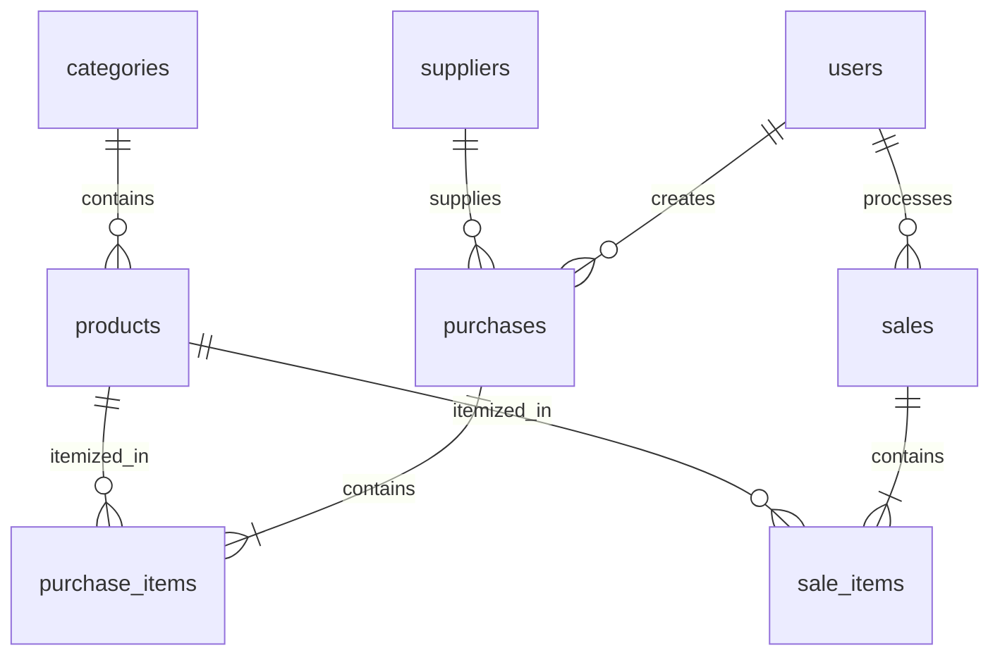

# Laporan Proyek UTS: ZENITH Coffee & Roastery

**Mata kuliah:** Web Programming 2
**Jenis proyek:** Sistem Point of Sale (POS), pemesanan, dan manajemen stok kafe
**Teknologi:** PHP 8.2+, Laravel 11, Blade, Tailwind CSS, Alpine.js, MySQL

> Dokumen ini merangkum aplikasi yang ada di repository. Kode di dalam folder `app/`, `routes/`, `resources/`, dan `database/` adalah sumber implementasi yang sebenarnya; dokumentasi ini tidak menyalin ulang source code agar tidak berbeda dari aplikasi.

## Daftar isi

1. [Ringkasan aplikasi](#1-ringkasan-aplikasi)
2. [Pengguna dan hak akses](#2-pengguna-dan-hak-akses)
3. [Fitur dan alur aplikasi](#3-fitur-dan-alur-aplikasi)
4. [Model data](#4-model-data)
5. [Aturan transaksi dan konsistensi stok](#5-aturan-transaksi-dan-konsistensi-stok)
6. [Pengujian](#6-pengujian)
7. [Instalasi lokal](#7-instalasi-lokal)
8. [Pemetaan Slide 26 dan 27](#8-pemetaan-slide-26-dan-27)
9. [Rujukan source code](#9-rujukan-source-code)

## 1. Ringkasan aplikasi

ZENITH Coffee & Roastery adalah aplikasi web untuk operasional kafe. Antarmuka menggunakan identitas merek kopi dengan warna navy, amber, dan emerald. Sistem menyediakan portal Pelanggan untuk melihat menu dan memesan, serta dashboard internal untuk operasional Staff dan Owner.

Fokus aplikasi adalah menghubungkan katalog produk, pasokan dari supplier, transaksi POS, dan perubahan stok. Produk yang dicontohkan seeder meliputi minuman kopi, minuman non-kopi, pastry, serta biji kopi kemasan.

## 2. Pengguna dan hak akses

| Peran | Kemampuan utama |
| --- | --- |
| Owner | Akses dashboard internal, data master, manajemen pengguna, transaksi, dan pembatalan transaksi |
| Admin | Alias peran administratif yang didukung model dan middleware |
| Staff | Melihat katalog internal, mencatat pasokan, dan memproses penjualan |
| Pelanggan | Melihat katalog yang tersedia, membuat pesanan, dan melihat riwayat pesanan sendiri |
| Pembeli | Alias untuk peran Pelanggan yang didukung model dan middleware |

Route yang memerlukan sesi dilindungi middleware autentikasi. Route administratif dilindungi `RoleMiddleware`; pembatasan bukan hanya berdasarkan menu yang ditampilkan. Pengujian fitur mencakup akses yang ditolak bagi Staff/Pelanggan pada sejumlah route administratif.

### Akun demo

Seeder membuat akun berikut dengan kata sandi `password123`:

| Peran | Email |
| --- | --- |
| Owner | `owner@example.com` |
| Staff | `staff@example.com` |
| Pelanggan | `pelanggan@example.com` |

Akun tersebut hanya ditujukan untuk pengembangan dan demonstrasi lokal. Jangan gunakan kata sandi demo di lingkungan publik.

## 3. Fitur dan alur aplikasi

- **Autentikasi:** login dan logout.
- **Dashboard internal:** ringkasan jumlah produk dan transaksi, nilai stok, penjualan/pembelian, peringatan stok rendah, serta transaksi terbaru.
- **Portal Pelanggan:** katalog produk yang tersedia, ringkasan jumlah dan nilai pesanan, serta riwayat pesanan akun.
- **Produk/menu:** katalog, detail, pencarian/filter, dan pengelolaan khusus Owner/Admin.
- **Data master:** pengelolaan kategori, supplier, dan pengguna oleh Owner/Admin.
- **Pasokan:** pencatatan pembelian multi-item yang menambah stok.
- **POS dan pemesanan:** penjualan multi-item dengan harga dari database dan pemeriksaan stok.
- **Pembatalan:** Owner/Admin dapat membatalkan transaksi; penyesuaian stok dilakukan sesuai jenis transaksi.
- **Antarmuka:** Blade dengan Tailwind CSS dan Alpine.js yang dimuat melalui CDN. Koneksi internet diperlukan untuk memuat aset CDN.

## 4. Model data

Database memiliki delapan tabel inti:

| Tabel | Kegunaan |
| --- | --- |
| `users` | Akun, kredensial, dan peran |
| `categories` | Kategori menu/produk |
| `suppliers` | Data pemasok |
| `products` | SKU, kategori, harga beli/jual, stok, batas minimum, dan soft delete |
| `purchases` | Header transaksi pasokan |
| `purchase_items` | Rincian produk dan kuantitas yang dibeli |
| `sales` | Header transaksi POS/pesanan |
| `sale_items` | Rincian produk, kuantitas, dan harga saat transaksi |

### ERD



Setiap item transaksi menyimpan kuantitas, harga satuan saat transaksi, dan subtotal. Produk memiliki SKU unik, kategori, stok saat ini, dan batas minimum stok.

## 5. Aturan transaksi dan konsistensi stok

### Pasokan

- Header dan rincian pembelian dibuat di dalam `DB::transaction()`.
- Setiap produk dikunci untuk diperbarui sebelum stok ditambah.
- Stok bertambah sesuai kuantitas dan harga beli terakhir produk diperbarui.
- Pembatalan pembelian memeriksa jumlah stok sebelum mengurangi kembali stok yang ditambahkan.

### Penjualan

- Header dan rincian penjualan dibuat di dalam `DB::transaction()`.
- Harga satuan dan total dihitung di server dari data produk dan kuantitas.
- Produk dikunci untuk diperbarui; transaksi ditolak jika stok tidak cukup.
- Stok dikurangi setelah validasi. Kegagalan pada item akan me-rollback seluruh transaksi.
- Pelanggan hanya dapat melihat riwayat/detail pesanan miliknya.
- Pembatalan penjualan oleh Owner/Admin mengembalikan stok produk.

Peringatan stok rendah menggunakan kondisi `stock <= minimum_stock`. Seeder menyertakan produk stok rendah dan produk habis untuk membantu demonstrasi.

## 6. Pengujian

Jalankan seluruh feature test:

```powershell
php artisan test
```

Pengujian mencakup autentikasi, validasi produk, otorisasi role, penambahan stok pembelian, pengurangan stok penjualan, penolakan saat stok kurang, dan rollback transaksi. Konfigurasi PHPUnit menggunakan SQLite in-memory agar pengujian tidak memakai database kerja lokal.

## 7. Instalasi lokal

Lihat [README.md](./README.md) untuk langkah instalasi lengkap. Ringkasnya:

```powershell
git clone https://github.com/zaleee07/project-uts.git
cd project-uts
composer install
Copy-Item .env.example .env
php artisan key:generate
```

Siapkan database MySQL `inventory_sales_db`, periksa konfigurasi `.env`, lalu jalankan:

```powershell
php artisan migrate --seed
php artisan serve
```

Buka <http://127.0.0.1:8000>. Tailwind CSS dan Alpine.js menggunakan CDN.

## 8. Pemetaan Slide 26 dan 27

Fondasi yang dapat diterapkan kembali pada project akhir mencakup pemodelan relasional, pemisahan hak akses, validasi server-side, transaksi atomik, dan pengujian. Contohnya, pola header-detail transaksi dapat diterapkan pada manifes dan event pengiriman; penguncian stok dapat menjadi referensi saat mengelola kapasitas armada.

Pemetaan langkah kerja dan contoh pertanyaan demo dijelaskan lebih lanjut pada:

- [Dokumentasi Slide 26 dan 27](./SLIDE_26_DAN_27_DOCUMENTATION.md)
- [Panduan Code Ownership Interview](./INTERVIEW_DEFENSE_GUIDE.md)

## 9. Rujukan source code

- Routing dan akses: [routes/web.php](./routes/web.php), [RoleMiddleware.php](./app/Http/Middleware/RoleMiddleware.php)
- Dashboard: [DashboardController.php](./app/Http/Controllers/DashboardController.php)
- Pembelian: [PurchaseController.php](./app/Http/Controllers/PurchaseController.php)
- Penjualan: [SaleController.php](./app/Http/Controllers/SaleController.php)
- Pengguna: [User.php](./app/Models/User.php)
- Seeder akun: [UserSeeder.php](./database/seeders/UserSeeder.php)
- Pengujian role: [RoleAuthorizationTest.php](./tests/Feature/RoleAuthorizationTest.php)
