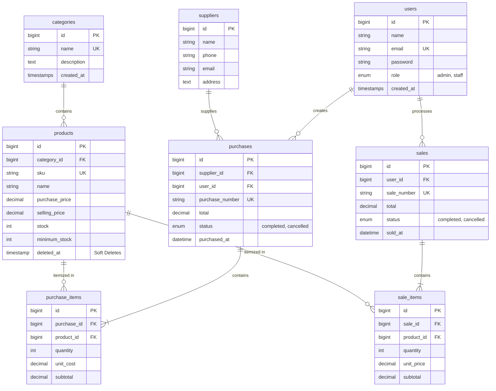

# Integrated Laravel Project: Inventory & Sales Management System
> **Mata Kuliah:** Web Programming 2 | **Evaluasi:** Ujian Tengah Semester (UTS)  
> **Framework:** Laravel 11 (PHP 8.2+) | **Database:** MySQL / SQLite | **Frontend:** Blade + Tailwind CSS

---

## 1. Project Overview & Business Scenario
Aplikasi ini dibangun untuk menyelesaikan permasalahan operasional pada usaha distribusi skala kecil hingga menengah:
- **Pencatatan Master Data:** Mengelola Kategori, Produk (dengan SKU unik), dan Pemasok (Supplier).
- **Konsistensi Stok Real-time:** Menjaga stok selalu sinkron secara otomatis saat barang masuk (*Purchase/Stock-in*) dan barang keluar (*Sales/Stock-out*).
- **Proteksi Transaksi Bersamaan (Concurrency Control):** Menggunakan `Product::lockForUpdate()` dan `DB::transaction()` untuk mencegah *race condition* dan *overselling* saat beberapa staf memproses penjualan secara simultan.
- **Role-Based Access Control (RBAC):** Pemisahan hak akses server-side antara **Admin / Owner** dan **Staff**.
- **Dashboard & Analitik:** Menyajikan metrik pendapatan harian, bulanan, total transaksi, dan deteksi dini barang dengan stok kritis (*Low Stock Alert*).

---

## 2. Entity Relationship Diagram (ERD) & Relasi Data



### Penjelasan Relasi Eloquent
1. **`Category hasMany Product`** & **`Product belongsTo Category`**: Satu kategori dapat menaungi banyak produk. Foreign key `category_id` terletak pada tabel `products` dengan aturan `onDelete('restrict')` agar kategori yang masih memiliki produk tidak terhapus.
2. **`Supplier hasMany Purchase`** & **`Purchase belongsTo Supplier`**: Pemasok menyuplai transaksi pengadaan barang.
3. **`Purchase hasMany PurchaseItem`** & **`Sale hasMany SaleItem`**: Pola Header-Detail (Master-Detail). Tabel header menyimpan metadata transaksi (nomor faktur, user, tanggal, status, total), sedangkan detail item menyimpan rincian barang, harga per unit saat transaksi, dan subtotal.
4. **`Product hasMany SaleItems`** & **`Product hasMany PurchaseItems`**: Riwayat mutasi barang masuk dan keluar dapat ditelusuri (*audit trail*) secara lengkap per produk.

---

## 3. Akun Demo Pengujian (Seeded Credentials)

| Role | Nama Akun | Alamat Email | Kata Sandi | Hak Akses Utama |
| :--- | :--- | :--- | :--- | :--- |
| **Admin / Owner** | Budi Santoso | `admin@example.com` | `password123` | Akses penuh: Kelola Pengguna, CRUD Kategori, Produk, Supplier, Pembatalan Transaksi, Dashboard. |
| **Staff Kasir** | Siti Rahma | `staff@example.com` | `password123` | Buat Pembelian (Stock-in), Buat Penjualan (Stock-out), Lihat Katalog & Riwayat Transaksi. |
| **Staff Operasional** | Ahmad Fauzi | `staff2@example.com` | `password123` | Operasional transaksi harian kasir dan penerimaan gudang. |

---

## 4. Langkah Instalasi & Reproducibility (Clean Environment)

Ikuti langkah-langkah di bawah ini untuk menjalankan project dari fresh repository:

### Langkah 1: Clone atau Buka Folder Project
```bash
git clone <repository-url>
cd inventory-sales
```

### Langkah 2: Instalasi Dependensi Composer
```bash
composer install
```

### Langkah 3: Konfigurasi File Environment (.env)
Salin contoh environment dan buat APP_KEY:
```bash
cp .env.example .env
php artisan key:generate
```

### Langkah 4: Pengaturan Database
Buka file `.env` dan pastikan kredensial database sesuai dengan server MySQL lokal Anda:
```env
DB_CONNECTION=mysql
DB_HOST=127.0.0.1
DB_PORT=3306
DB_DATABASE=inventory_sales_db
DB_USERNAME=root
DB_PASSWORD=
```
*(Catatan: Buat database kosong bernama `inventory_sales_db` di phpMyAdmin / MySQL terlebih dahulu).*

### Langkah 5: Jalankan Migration & Seeder
Perintah ini akan menyusun seluruh tabel, foreign key, index, serta mengisi data dummy realistis (akun, kategori, supplier, produk dengan stok rendah, riwayat pembelian, dan penjualan):
```bash
php artisan migrate --seed
```

### Langkah 6: Jalankan Server Lokal
```bash
php artisan serve
```
Buka browser dan akses aplikasi melalui: **`http://127.0.0.1:8000`**

---

## 5. Ringkasan Fitur Aplikasi

- [x] **Autentikasi & RBAC Server-Side:** Login, logout, proteksi route melalui `RoleMiddleware`, pesan error ramah pengguna.
- [x] **Master Data Kategori:** CRUD lengkap dengan validasi nama unik dan proteksi relasi produk.
- [x] **Master Data Pemasok:** CRUD data kontak supplier beserta riwayat pengadaan.
- [x] **Master Data Produk & SKU Unik:** Validasi server-side (`min:0`), SKU unik, relasi kategori, soft deletes untuk produk bertransaksi.
- [x] **Transaksi Pembelian (Stock-in):** Penambahan multi-item dinamis (JS), kalkulasi total di server, penambahan stok otomatis secara atomik.
- [x] **Transaksi Penjualan (Stock-out):** Proteksi *lockForUpdate*, penolakan transaksi jika stok kurang, pengurangan stok otomatis, faktur struk siap cetak.
- [x] **Pembatalan Transaksi (Admin Only):** Membatalkan transaksi dan memulihkan/menyesuaikan kembali saldo stok secara konsisten via `DB::transaction()`.
- [x] **Pencarian, Filter, & Pagination:** Filter tanggal, kategori, status transaksi, kata kunci SKU/nama, mempertahankan query string URL (`withQueryString()`).
- [x] **Dashboard Analitik:** Metrik agregat database nyata (penjualan hari ini, bulan ini, total transaksi, peringatan produk stok rendah/kritis).

---

## 6. Menjalankan Automated Test Suite (Testing)
Aplikasi dilengkapi unit/feature test suite mencakup skenario otentikasi, otorisasi role, validasi produk, penambahan stok pembelian, pengurangan stok penjualan, serta pengujian atomicity rollback:
```bash
php artisan test
```
Seluruh pengujian berjalan menggunakan SQLite in-memory database secara terisolasi tanpa mengganggu data kerja lokal.

---

## 7. Panduan Khusus Slide 26 & 27
Untuk penjelasan lengkap mengenai:
- **Slide 26:** *Transfer of Skills* dari Inventory & Sales ke Final Project (Tracking, Shipment, Exceptions, API).
- **Slide 27:** Rekapitulasi eksekusi Work Plan 9 langkah secara terstruktur.
- **Slide 24:** Jawaban lengkap dan komprehensif atas 8 pertanyaan *Code Ownership Interview* dari dosen.

Silakan pelajari dokumen pendukung yang disertakan:
1. [SLIDE_26_DAN_27_DOCUMENTATION.md](file:///C:/Users/USER/.gemini/antigravity/scratch/inventory-sales/SLIDE_26_DAN_27_DOCUMENTATION.md)
2. [INTERVIEW_DEFENSE_GUIDE.md](file:///C:/Users/USER/.gemini/antigravity/scratch/inventory-sales/INTERVIEW_DEFENSE_GUIDE.md)
