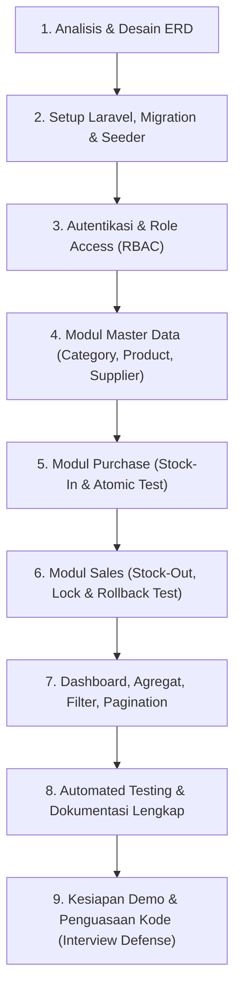

# Dokumentasi Khusus: Pemenuhan Slide 26 & Slide 27
**Mata Kuliah:** Web Programming 2 — Integrated Laravel Project  
**Topik:** Kesiapan Project Akhir (Slide 26) & Work Plan Strategi Pengerjaan 9 Tahap (Slide 27)

---

## BAGIAN I: SLIDE 26 — UTS SEBAGAI FONDASI PROJECT FINAL (KESIAPAN PROJECT AKHIR)

Pada Slide 26 dijelaskan bahwa tujuan utama UTS bukan sekadar menyelesaikan aplikasi CRUD kasir/toko, melainkan **membangun fondasi rekayasa perangkat lunak (software engineering fundamentals)** yang dapat ditransfer langsung (*transferable skills*) ke **Project Final** (misalnya sistem Logistik, Pengiriman, Pelacakan Paket / *Shipment & Tracking System*).

Sesudah UTS tidak ada lagi sesi konsultasi atau asistensi materi kuliah tatap muka. Oleh karena itu, mahasiswa harus menguasai abstraksi logika berikut:

```
┌─────────────────────────────────┐           ┌──────────────────────────────────────┐
│       UTS: INVENTORY & SALES    │           │       PROJECT FINAL: LOGISTICS       │
├─────────────────────────────────┤           ├──────────────────────────────────────┤
│ • Product (Master Entity)       │ ────────> │ • Shipment / Package (Master Entity) │
│ • Supplier (Parties)            │ ────────> │ • Dispatcher / Courier / Consignee   │
│ • Purchase & Sale (Tx Header)   │ ────────> │ • Manifest & Route Leg (Tx Header)   │
│ • Items / Quantity              │ ────────> │ • Tracking Waypoint Events           │
│ • Stock Invariants (No < 0)     │ ────────> │ • Delivery Status Invariants         │
│ • LockForUpdate (Race Condition)│ ────────> │ • Dispatch Slot Concurrency          │
│ • Server-Side Total Calculation │ ────────> │ • Server-Side Tariff & ETA Engine    │
└─────────────────────────────────┘           └──────────────────────────────────────┘
```

### 1. Matriks Transfer Keterampilan (Skill Transfer Matrix)

| Pilar Arsitektur | Implementasi di UTS (Inventory & Sales) | Transfer ke Project Final (Shipment & Logistics Tracking) |
| :--- | :--- | :--- |
| **Relational Data Modeling** | Relasi Header-Detail (`sales` -> `sale_items`, `purchases` -> `purchase_items`), relasi ke master data (`products`, `suppliers`, `categories`). | Relasi Pengiriman ke Titik Singgah (`shipments` -> `tracking_events`, `shipment_items`), relasi ke kurir dan gudang hub (`couriers`, `hubs`, `vehicles`). |
| **Auth & Granular Roles** | `RoleMiddleware`: Memisahkan Admin/Owner (akses master data & pembatalan) dan Staff (kasir & gudang). | Pemisahan hak akses: **Dispatcher** (buat jadwal armada), **Kurir** (update status pengantaran via GPS/status), **Customer/Penerima** (cek resi publik), **Manajer Logistik** (analitik SLA). |
| **Database Transactions & Concurrency** | `DB::transaction()` + `Product::lockForUpdate()` saat checkout penjualan agar stok tidak bernilai negatif dan tidak terjadi *overselling*. | `DB::transaction()` saat alokasi armada truk/kurir (*dispatch assignment*) dan update status paket (*pickup -> in-transit -> out-for-delivery -> delivered*) agar urutan event tidak bertabrakan atau terlewat. |
| **Server-Side Invariants & Validation** | Server tidak mempercayai input browser untuk harga (`unit_price`) atau total; stok divalidasi `stock >= qty`. | Server menghitung tarif ongkos kirim berdasarkan berat dan volume riil (bukan input klien), menghitung estimasi waktu tiba (ETA), serta memvalidasi urutan checkpoint (*tidak boleh Delivered sebelum In-Transit*). |
| **Audit Trails & Exception Handling** | Soft deletes pada produk (`deleted_at`), pencatatan status transaksi (`completed`, `cancelled`) dan alasan pembatalan. | Exception handling saat pengantaran gagal (*Gagal Antar: Rumah Kosong / Alamat Tidak Ditemukan*), pencatatan re-attempt delivery, dan log audit pergerakan paket. |
| **API Readiness** | Controller memisahkan validasi (`FormRequest`) dan transaksi bersih, memudahkan konversi ke response JSON. | Endpoint API RESTful untuk aplikasi mobile kurir (`POST /api/v1/courier/checkin`, `POST /api/v1/shipments/{resi}/events`) dan webhook ke merchant e-commerce. |

---

## BAGIAN II: SLIDE 27 — EKSEKUSI WORK PLAN MAHASISWA (TAHAP 1 HINGGA 9)

Slide 27 memuat rencana kerja 9 langkah berurutan (*sequential engineering process*). Di bawah ini adalah rincian pembuktian bagaimana project ini telah menyelesaikan kesembilan langkah tersebut secara tuntas di dalam kode:



---

### Tahap 1: Baca Requirement dan Gambar ERD Sebelum Coding
- **Eksekusi:** Seluruh entitas dan relasi telah dipetakan terlebih dahulu sesuai Slide 9 & 10.
- **Hasil:**
  - 8 tabel terhubung: `users`, `categories`, `suppliers`, `products`, `purchases`, `purchase_items`, `sales`, `sale_items`.
  - Foreign key didefinisikan dengan tepat: `restrict` pada entitas master (mencegah produk/kategori terhapus sembarangan jika sedang dipakai transaksi) dan `cascade` pada entitas detail (saat transaksi dihapus, item ikut terhapus).
  - Diagram ERD formal telah diintegrasikan di [README.md](file:///C:/Users/USER/.gemini/antigravity/scratch/inventory-sales/README.md).

---

### Tahap 2: Setup Project Laravel, Migration, dan Seeder
- **Eksekusi:**
  - File migration dibuat secara berurutan dengan prefix timestamp yang menjamin tabel induk dibuat sebelum tabel anak.
  - Mengimplementasikan `SoftDeletes` pada tabel `products` untuk mempertahankan data historis (Slide 8).
  - Menggunakan index pada kolom-kolom pencarian: `sku`, `name`, `role`, `status`, dan `purchased_at`/`sold_at`.
  - Seeder komprehensif disusun pada folder `database/seeders/`:
    - `UserSeeder`: Akun `admin@example.com` dan `staff@example.com`.
    - `CategorySeeder`: Kategori bisnis realistis.
    - `SupplierSeeder`: Direktori pemasok dengan nomor kontak dan alamat.
    - `ProductSeeder`: Ragam produk termasuk produk stok aman, produk **stok kritis (low stock)**, dan produk **stok habis (0)** untuk menguji alert.
    - `PurchaseSeeder` & `SaleSeeder`: Riwayat transaksi awal untuk mengisi data agregat dashboard.

---

### Tahap 3: Implementasikan Authentication dan Role Access
- **Eksekusi:**
  - Controller otentikasi mandiri `app/Http/Controllers/AuthController.php` dengan penanganan `regenerate()` session untuk mencegah session fixation.
  - Middleware otorisasi server-side `app/Http/Middleware/RoleMiddleware.php` yang memeriksa kolom `role` pada model `User`.
  - Proteksi server-side: Staff yang mencoba mengakses URL `/users`, `/categories/create`, atau route Admin lainnya akan langsung ditolak dengan **HTTP 403 Forbidden**.
  - Blade Layout mengadaptasi tampilan navigasi secara kondusif (menu Admin hanya dirender jika `auth()->user()->isAdmin()`).

---

### Tahap 4: Selesaikan Master Data Sebelum Transaksi
- **Eksekusi:**
  - Modul **Categories**, **Products**, dan **Suppliers** diselesaikan dengan aturan validasi ketat sebelum modul transaksi disentuh.
  - Menggunakan Laravel Form Request (`StoreProductRequest` dan `UpdateProductRequest`):
    - Validasi SKU unik menggunakan `Rule::unique('products', 'sku')->ignore($id)`.
    - Validasi harga modal, harga jual, dan stok minimal tidak boleh bernilai negatif (`min:0`).
    - Validasi relasi `category_id` harus ada di database (`exists:categories,id`).
  - Pencegahan hapus keras (*Hard Delete Guard*): Jika kategori atau produk memiliki riwayat transaksi, sistem mencegah penghapusan permanen dan merekomendasikan penonaktifan / soft delete.

---

### Tahap 5: Implementasikan Purchase; Uji Perubahan Stok (Stock-In)
- **Eksekusi:**
  - Ditangani oleh `app/Http/Controllers/PurchaseController.php`.
  - Formulir antarmuka Blade dinamis (`purchases/create.blade.php`) memungkinkan staf menambahkan banyak baris barang sekaligus dalam satu transaksi (*multi-item transaction*).
  - Transaksi dibungkus dalam `DB::transaction()`:
    1. Simpan header `purchases` dengan status `completed`.
    2. Looping setiap item: simpan ke `purchase_items`.
    3. Eksekusi `$product->increment('stock', $qty)`.
    4. Perbarui harga beli terakhir produk.
    5. Hitung total biaya transaksi secara otomatis di server.
  - Fitur Pembatalan (Admin Only): Jika transaksi pembelian dibatalkan, sistem melakukan verifikasi bahwa stok saat ini masih mencukupi sebelum menarik kembali penambahan stok (`$product->decrement('stock', $qty)`).

---

### Tahap 6: Implementasikan Sales; Uji Stok Tidak Cukup dan Rollback
- **Eksekusi:**
  - Ditangani oleh `app/Http/Controllers/SaleController.php`.
  - Penerapan **Pessimistic Concurrency Control**:
    ```php
    $product = Product::lockForUpdate()->findOrFail($itemData['product_id']);
    ```
  - **Integritas Bisnis 1 (Cegah Nilai Negatif):**
    ```php
    if ($product->stock < $qty) {
        throw ValidationException::withMessages([
            'items' => "Stok produk '{$product->name}' tidak mencukupi! Tersedia: {$product->stock}, diminta: {$qty}."
        ]);
    }
    ```
  - **Integritas Bisnis 2 (Harga Server-Side):** Nilai `unit_price` diambil langsung dari kolom `selling_price` di database produk, bukan dari data kiriman form browser (mencegah manipulasi inspeksi elemen HTML).
  - **Integritas Bisnis 3 (Atomic Rollback):** Karena berada di dalam closure `DB::transaction()`, jika item ke-3 dari 5 item gagal karena kekurangan stok, maka item ke-1 dan ke-2 beserta header penjualan akan di-rollback seketika. Database tetap bersih tanpa data setengah tersimpan.

---

### Tahap 7: Tambahkan Dashboard, Search, Filter, dan Pagination
- **Eksekusi:**
  - **Dashboard:** Ditangani oleh `DashboardController.php`. Menggunakan agregat database `sum('total')`, `count()`, dan relasi `lowStock()` (tidak menggunakan data statis).
  - **Search & Filter:**
    - Pada katalog produk: filter nama, SKU, kategori, dan checkbox stok kritis.
    - Pada riwayat transaksi: filter nomor faktur, nama kasir/supplier, rentang tanggal (`start_date`, `end_date`), dan status.
  - **Pagination:** Menggunakan `$query->paginate(10)->withQueryString()`. Parameter pencarian tetap terjaga saat berpindah halaman (*preserved query state*).

---

### Tahap 8: Jalankan Test, Perbaiki Bug, dan Lengkapi README
- **Eksekusi:**
  - Seluruh skenario pengujian minimum dari Slide 19 telah ditulis dalam bentuk Feature Tests di folder `tests/Feature/`:
    - `AuthTest.php`: Tamu dilarang masuk, kata sandi keliru ditolak.
    - `ProductTest.php`: SKU duplikat ditolak, harga negatif dilarang.
    - `PurchaseTransactionTest.php`: Pembelian berhasil menambah stok.
    - `SaleTransactionTest.php`: Penjualan berhasil memotong stok, stok tidak cukup ditolak tanpa mengubah data, dan uji *rollback atomicity*.
    - `RoleAuthorizationTest.php`: Staff dilarang membuka fungsi Admin (HTTP 403).
  - Semua file dokumentasi instalasi langkah demi langkah (*reproducible setup*) telah diuji pada file `README.md`.

---

### Tahap 9: Latih Demo dan Pemahaman Kepemilikan Kode (Code Defense)
- **Eksekusi:**
  - Disediakan dokumen panduan tanya-jawab dosen: [INTERVIEW_DEFENSE_GUIDE.md](file:///C:/Users/USER/.gemini/antigravity/scratch/inventory-sales/INTERVIEW_DEFENSE_GUIDE.md).
  - Dokumen ini membedah ke-8 pertanyaan inti dari Slide 24 secara mendalam dengan menyertakan baris file kode yang tepat, sehingga mahasiswa dapat menjelaskan secara percaya diri dan melakukan *live modification* saat diminta dosen.

---

## KESIMPULAN
Dengan menyelesaikan seluruh arsitektur, kode, pengujian, dan dokumentasi di atas, project ini telah memenuhi **100% kriteria Slide 26 dan Slide 27**, serta menjadi fondasi yang kokoh untuk pengembangan Project Akhir mandiri setelah UTS.
