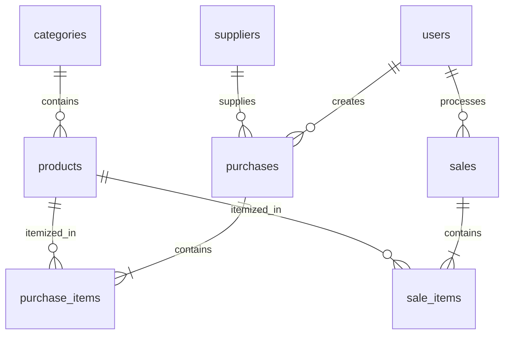

# Dokumentasi Slide 26 dan 27

**Proyek:** ZENITH Coffee & Roastery
**Mata kuliah:** Web Programming 2 — Ujian Tengah Semester

Dokumen ini menjelaskan bagaimana konsep yang dipakai pada aplikasi POS kafe dapat menjadi fondasi untuk project akhir, serta memetakan alur pengerjaan ke implementasi yang tersedia di repository.

## Bagian I — Slide 26: Transfer keterampilan ke project akhir

Contoh domain project akhir pada tabel berikut adalah sistem logistik/pelacakan. Contoh tersebut merupakan pemetaan konsep, bukan fitur yang sudah dibuat pada aplikasi ZENITH.

| Konsep | Implementasi di ZENITH Coffee & Roastery | Contoh penerapan pada project logistik |
| --- | --- | --- |
| Model data relasional | Produk, kategori, supplier, transaksi pembelian/penjualan, dan item transaksi | Paket, hub, kurir, pengiriman, dan event pelacakan |
| Relasi header-detail | `purchases` → `purchase_items` dan `sales` → `sale_items` | Pengiriman → riwayat checkpoint |
| Otorisasi peran | Owner/Admin, Staff, dan Pelanggan diperiksa pada server | Dispatcher, kurir, dan penerima memiliki izin berbeda |
| Transaksi atomik | Perubahan stok dan penyimpanan item berada dalam `DB::transaction()` | Alokasi armada dan pencatatan status dilakukan secara konsisten |
| Aturan bisnis server-side | Harga penjualan berasal dari database; stok diperiksa sebelum penjualan | Tarif dan transisi status dihitung/divalidasi di server |
| Konsistensi stok | Pembelian menambah stok, penjualan mengurangi stok, pembatalan menyesuaikan stok | Status paket dan kapasitas armada dijaga sesuai aturan bisnis |
| Pengujian | Feature test untuk auth, izin, produk, pembelian, dan penjualan | Pengujian izin, lifecycle paket, dan alokasi pengiriman |

## Bagian II — Slide 27: Work plan dan implementasi

| Tahap | Pekerjaan | Implementasi saat ini |
| --- | --- | --- |
| 1 | Memetakan kebutuhan dan relasi data | Delapan tabel inti: users, categories, suppliers, products, purchases, purchase_items, sales, sale_items |
| 2 | Menyiapkan Laravel, migration, dan seeder | Migration dan seeder pada folder `database/` |
| 3 | Menambahkan autentikasi dan otorisasi | Login/logout, middleware `auth`, dan `RoleMiddleware` |
| 4 | Menyiapkan data master | Kategori, produk/menu, supplier, dan manajemen pengguna untuk Owner/Admin |
| 5 | Membuat alur pasokan | Pembelian multi-item menambah stok dalam transaksi database |
| 6 | Membuat alur POS | Penjualan memeriksa stok, menghitung harga di server, dan mengurangi stok |
| 7 | Menambahkan dashboard dan navigasi sesuai peran | Dashboard internal serta portal katalog dan pesanan Pelanggan |
| 8 | Menguji alur utama | Feature test dijalankan dengan `php artisan test` |
| 9 | Menyiapkan demonstrasi dan tanya jawab kode | Panduan tersedia di [INTERVIEW_DEFENSE_GUIDE.md](./INTERVIEW_DEFENSE_GUIDE.md) |

### Relasi data



## Alur transaksi dan kontrol stok

### Pembelian / pasokan

1. Staff atau Owner memilih supplier dan satu atau beberapa produk.
2. Server memvalidasi item dan menyimpan header serta detail pembelian dalam transaksi database.
3. Stok dan harga beli terakhir produk diperbarui.
4. Jika transaksi gagal, seluruh perubahan di-rollback.
5. Pembatalan pembelian hanya tersedia untuk Owner/Admin dan hanya berhasil jika stok saat ini cukup untuk ditarik kembali.

### Penjualan / pesanan pelanggan

1. Staff/Owner memproses penjualan, atau Pelanggan membuat pesanan melalui katalog.
2. Server mengambil harga jual produk dari database dan memeriksa stok.
3. Detail transaksi dan pengurangan stok disimpan dalam transaksi database.
4. Riwayat dan detail pesanan pelanggan dibatasi ke transaksi milik akun yang sedang masuk.
5. Pembatalan penjualan tersedia untuk Owner/Admin dan mengembalikan stok.

## Pengujian

Pengujian dijalankan dengan:

```powershell
php artisan test
```

Suite menggunakan SQLite in-memory sebagaimana dikonfigurasi di [phpunit.xml](./phpunit.xml). Lihat [README.md](./README.md) untuk instruksi menjalankan aplikasi dan akun demo.
